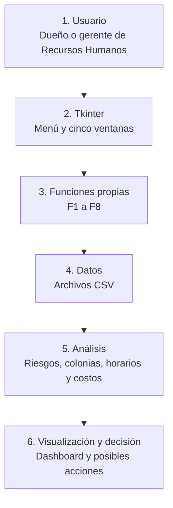

# App-programacion
Aqui estara lo que usaremos para la creación de la app

Aquí va con una redacción más sencilla y natural, manteniendo el contenido y el formato para GitHub:

````markdown
# LlegaBien — Plan de nuestro MVP

**Equipo:** Matías, Paolo, Rogelio y Mateo.

Nuestra app se llama LlegaBien. Está pensada para que el dueño de una empresa o el personal de Recursos Humanos pueda saber qué trabajadores tienen problemas con su traslado, en qué colonias se concentran y cuánto podría costarle a la empresa la rotación relacionada con este problema.

Para la primera versión vamos a adaptar la Starter App del curso. Actualmente trabaja con datos de tráfico en intersecciones, así que cambiaremos sus formularios, datos y cálculos para trabajar con información de los trabajadores.

## 1. Priorización MoSCoW

**Responsable de esta parte: Matías.**

Dividimos las funciones según lo necesarias que son para que la primera versión de la app cumpla su objetivo.

### Must Have

Estas son las partes que necesitamos para demostrar que nuestra propuesta funciona:

- Una pantalla de inicio que explique el problema, a quién va dirigida la app y para qué sirve.
- Un formulario para registrar trabajadores.
- Una tabla con los trabajadores y su nivel de riesgo.
- Un semáforo que clasifique el riesgo en alto, medio y bajo.
- Una lista con las tres colonias que tengan más trabajadores en riesgo alto.
- Una calculadora del costo de la rotación.

Las pusimos como indispensables porque con ellas podemos mostrar qué está pasando, dónde se concentra el problema y cuánto le cuesta a la empresa.

### Should Have

Estas funciones ayudarían a tomar mejores decisiones, aunque la app puede funcionar sin ellas:

- Encontrar el horario de entrada con más retardos por trabajador.
- Calcular cuántas renuncias tendría que evitar una ruta de transporte para cubrir su costo.
- Generar alertas.
- Mostrar mensajes claros cuando se capture un dato incorrecto.

### Could Have

Estas mejoras las agregaríamos si nos alcanza el tiempo:

- Una gráfica de riesgo por colonia con Matplotlib, usando el Technology Booster.
- Consultar una API para estimar tiempos de traslado durante el periodo 3.
- Guardar el reporte en un archivo.
- Comparar una encuesta inicial con otra realizada después de un cambio.

Estas opciones mejorarían la presentación y el análisis, pero primero queremos que funcionen las partes principales.

## 2. Funciones del sistema

**Responsable de organizar esta parte: Paolo.**

Nos repartimos dos funciones por integrante:

| ID | Función | Para qué sirve | Prioridad | Responsable |
|---|---|---|---|---|
| F1 | `clasificar_riesgo` | Clasifica el traslado como alto, medio o bajo. | Must Have | Paolo |
| F2 | `resumir_plantilla` | Cuenta trabajadores por nivel y calcula el porcentaje que tarda 60 minutos o más. | Must Have | Rogelio |
| F3 | `colonias_con_mas_riesgo` | Encuentra las tres colonias con más trabajadores en riesgo alto. | Must Have | Rogelio |
| F4 | `calcular_costo_rotacion` | Estima el costo anual de la rotación. | Must Have | Matías |
| F5 | `hora_con_mas_retardos` | Encuentra el horario con mayor promedio de retardos por trabajador. | Should Have | Mateo |
| F6 | `ruta_se_paga` | Calcula cuántas renuncias debe evitar una ruta para cubrir su costo. | Should Have | Matías |
| F7 | `generar_alertas` | Genera mensajes sobre los resultados que necesitan atención. | Should Have | Mateo |
| F8 | `validar_trabajador` | Revisa los datos del formulario antes de guardarlos. | Should Have | Paolo |

### F1. clasificar_riesgo

**Nombre:** `clasificar_riesgo`

**Propósito:** Identificar si el traslado de un trabajador tiene un riesgo alto, medio o bajo. Vamos a reemplazar la función de la plantilla que clasificaba el riesgo usando flujo, velocidad e incidentes.

**Parámetros:**

- Minutos de traslado: número entero.
- Número de transbordos: número entero.

**Valor de retorno:** Un texto con el nivel de riesgo: `"ALTO"`, `"MEDIO"` o `"BAJO"`.

**Algoritmo o pseudocódigo:**

```text
Si minutos >= 60 o transbordos >= 2:
    regresar "ALTO"
Si no, si minutos >= 30 o transbordos == 1:
    regresar "MEDIO"
Si no:
    regresar "BAJO"
```

**Casos de prueba:**

| Minutos | Transbordos | Resultado |
|---|---|---|
| 65 | 0 | `"ALTO"` |
| 45 | 1 | `"MEDIO"` |
| 20 | 0 | `"BAJO"` |
| 20 | 2 | `"ALTO"` |

También probaremos los límites:

- 60 minutos y 0 transbordos → `"ALTO"`.
- 59 minutos y 0 transbordos → `"MEDIO"`.

**Responsable inicial:** Paolo.  
**Prioridad:** Must Have.

### F2. resumir_plantilla

**Nombre:** `resumir_plantilla`

**Propósito:** Hacer un resumen de cuántos trabajadores hay en cada nivel de riesgo y qué porcentaje tarda 60 minutos o más en llegar. Esta función reemplazará a `resumir_registros` de la plantilla.

**Parámetros:**

- Lista de trabajadores con sus datos, obtenida de `cargar_csv`.

**Valor de retorno:** Un diccionario con los conteos de riesgo alto, medio y bajo, y el porcentaje de trabajadores que tarda 60 minutos o más.

**Algoritmo o pseudocódigo:**

```text
Iniciar los contadores ALTO, MEDIO, BAJO y largos en 0

Para cada trabajador:
    nivel = clasificar_riesgo(sus minutos, sus transbordos)
    sumar 1 al contador de ese nivel

    Si tarda 60 minutos o más:
        sumar 1 a largos

porcentaje = largos / total de trabajadores * 100

Regresar los tres conteos y el porcentaje
```

**Caso de prueba:**

Tenemos cuatro trabajadores que tardan 70, 40, 10 y 15 minutos. Todos realizan 0 transbordos.

El resultado debe ser:

- Riesgo alto: 1.
- Riesgo medio: 1.
- Riesgo bajo: 2.
- Porcentaje que tarda 60 minutos o más: 25.0 %.

**Responsable inicial:** Rogelio.  
**Prioridad:** Must Have.

### F3. colonias_con_mas_riesgo

**Nombre:** `colonias_con_mas_riesgo`

**Propósito:** Encontrar las colonias donde viven más trabajadores con traslados de riesgo alto.

**Parámetros:**

- Lista de trabajadores.
- Cantidad de colonias que queremos mostrar: número entero. Si no se indica, se mostrarán 3.

**Valor de retorno:** Una lista de parejas con el nombre de la colonia y su cantidad de trabajadores en riesgo alto, ordenada de mayor a menor.

**Algoritmo o pseudocódigo:**

```text
Crear un diccionario vacío para contar por colonia

Para cada trabajador:
    Si clasificar_riesgo(sus minutos, sus transbordos) es "ALTO":
        sumar 1 al conteo de su colonia

Ordenar las colonias de mayor a menor
Regresar la cantidad de colonias solicitada
```

**Caso de prueba:**

- Colonia A: 3 trabajadores en riesgo alto.
- Colonia B: 1 trabajador en riesgo alto.
- Colonia C: 0 trabajadores en riesgo alto.

Resultado:

```text
[("A", 3), ("B", 1)]
```

**Responsable inicial:** Rogelio.  
**Prioridad:** Must Have.

### F4. calcular_costo_rotacion

**Nombre:** `calcular_costo_rotacion`

**Propósito:** Estimar cuánto le cuesta a la empresa la rotación durante un año y qué parte corresponde a salidas relacionadas con el traslado.

**Parámetros:**

- Número de empleados: entero.
- Rotación mensual en porcentaje: decimal.
- Costo por salida en pesos: decimal.
- Proporción de salidas relacionadas con el traslado: decimal entre 0 y 1.

**Valor de retorno:** Un diccionario con las salidas anuales, el costo total, las salidas por traslado y el costo de estas últimas.

**Algoritmo o pseudocódigo:**

```text
salidas = redondear(empleados * rotación / 100 * 12)
costo_total = salidas * costo_por_salida
salidas_por_traslado = redondear(salidas * proporción)
costo_por_traslado = salidas_por_traslado * costo_por_salida

Regresar los cuatro resultados
```

**Caso de prueba:**

Usaremos estos datos:

- 120 empleados.
- Rotación mensual del 6 %.
- Costo por salida de $47,000.
- Proporción por traslado de 0.2.

El resultado debe ser:

- 86 salidas al año.
- $4,042,000 de costo total.
- 17 salidas relacionadas con el traslado.
- $799,000 de costo por traslado.

**Responsable inicial:** Matías.  
**Prioridad:** Must Have.

### F5. hora_con_mas_retardos

**Nombre:** `hora_con_mas_retardos`

**Propósito:** Encontrar el horario de entrada con mayor promedio de retardos por trabajador.

**Parámetros:**

- Lista de trabajadores con su hora de entrada y sus retardos al mes.

**Valor de retorno:** Una pareja con la hora crítica y su promedio de retardos por trabajador.

**Algoritmo o pseudocódigo:**

```text
Crear un diccionario de retardos por hora
Crear otro diccionario de trabajadores por hora

Para cada trabajador:
    sumar sus retardos al horario que le corresponde
    sumar 1 al conteo de trabajadores de ese horario

Para cada horario:
    promedio = total de retardos / cantidad de trabajadores

Regresar el horario con mayor promedio y su promedio
```

**Caso de prueba:**

- A las 07:00 entran dos trabajadores con 3 y 1 retardos.
- A las 08:00 entran dos trabajadores con 0 y 1 retardos.

Resultado:

```text
("07:00", 2.0)
```

**Responsable inicial:** Mateo.  
**Prioridad:** Should Have.

### F6. ruta_se_paga

**Nombre:** `ruta_se_paga`

**Propósito:** Calcular cuántas renuncias tendría que evitar una ruta de transporte para cubrir su costo anual y compararlas con las salidas estimadas por traslado.

**Parámetros:**

- Costo mensual de la ruta: decimal.
- Costo por salida: decimal.
- Salidas por traslado al año: entero, obtenido de F4.

**Valor de retorno:** Una pareja con la cantidad de renuncias que se deben evitar y un valor verdadero o falso que indique si esa cantidad es menor o igual a las salidas estimadas por traslado.

**Algoritmo o pseudocódigo:**

```text
renuncias = redondear_hacia_arriba(
    costo_mensual_ruta * 12 / costo_por_salida
)

conviene = renuncias <= salidas_por_traslado

Regresar renuncias y conviene
```

**Caso de prueba:**

- Ruta de $20,000 al mes, como dato de prueba.
- Costo por salida de $47,000.
- 17 salidas por traslado al año.

Resultado:

```text
(6, verdadero)
```

Esto significa que la ruta tendría que evitar 6 renuncias al año para cubrir su costo.

**Responsable inicial:** Matías.  
**Prioridad:** Should Have.

### F7. generar_alertas

**Nombre:** `generar_alertas`

**Propósito:** Mostrar mensajes para que el dueño identifique los resultados que necesitan atención sin tener que revisar todos los datos.

**Parámetros:**

- Porcentaje de trabajadores que tarda 60 minutos o más: decimal, obtenido de F2.
- Lista de colonias con su conteo de trabajadores en riesgo alto: obtenida de F3.

**Valor de retorno:** Una lista de mensajes. Si no hay alertas, la lista estará vacía.

**Algoritmo o pseudocódigo:**

```text
Crear una lista vacía de alertas

Si el porcentaje es mayor a 20:
    agregar "Más de 20 % de la plantilla tarda 60 minutos o más"

Para cada colonia y su conteo:
    Si el conteo es 10 o más:
        agregar "Colonia ...: ... trabajadores en riesgo alto, evaluar una ruta"

Regresar la lista
```

**Caso de prueba:**

```text
Porcentaje: 25.0 %
Colonias: [("A", 11), ("B", 4)]
```

Deben aparecer dos alertas:

1. “Más de 20 % de la plantilla tarda 60 minutos o más”.
2. “Colonia A: 11 trabajadores en riesgo alto, evaluar una ruta”.

**Responsable inicial:** Mateo.  
**Prioridad:** Should Have.

### F8. validar_trabajador

**Nombre:** `validar_trabajador`

**Propósito:** Revisar los datos del formulario antes de guardarlos y mostrar un mensaje si alguno es incorrecto.

**Parámetros:**

- Minutos de traslado, transbordos y retardos como texto, tal como se escriben en el formulario.

**Valor de retorno:** Una pareja con verdadero o falso y un mensaje para el usuario.

**Algoritmo o pseudocódigo:**

```text
Intentar convertir los tres datos a números enteros

Si no se pueden convertir:
    regresar falso y "Minutos, transbordos y retardos deben ser números enteros"

Si alguno es negativo:
    regresar falso y "Los números no pueden ser negativos"

Regresar verdadero y "Datos correctos"
```

**Casos de prueba:**

| Minutos | Transbordos | Retardos | Resultado |
|---|---|---|---|
| `"45"` | `"1"` | `"2"` | Verdadero: “Datos correctos”. |
| `"abc"` | `"1"` | `"2"` | Falso: “Minutos, transbordos y retardos deben ser números enteros”. |
| `"-5"` | `"0"` | `"0"` | Falso: “Los números no pueden ser negativos”. |

**Responsable inicial:** Paolo.  
**Prioridad:** Should Have.

## 3. Personalización de la Starter App

**Responsable de esta parte: Rogelio.**

Vamos a aprovechar las ventanas de la Starter App, pero cambiaremos su contenido para que trabajen con los datos de nuestro proyecto.

### Menú principal

**Cómo está ahora:** Tiene el título “Movilidad Inteligente 2026” y cinco botones genéricos.

**Qué cambiaremos:** El título será “LlegaBien” y los botones serán:

- Inicio.
- Registrar trabajador.
- Datos de la plantilla.
- Diagnóstico.
- Fuente de datos.

**Archivo:** `src/app/main.py`

### Home

**Cómo está ahora:** Tiene un texto de ejemplo y un botón de “¿Por qué importa?” con un mensaje genérico.

**Qué cambiaremos:** Explicaremos:

- **El problema:** Las empresas no saben cómo llegan sus trabajadores.
- **El usuario:** Dueños y gerentes de Recursos Humanos de empresas medianas de León.
- **La propuesta:** Mostrar un diagnóstico con costos en pesos y posibles acciones.

En el botón usaremos los datos de referencia del proyecto: el 47 % de los empleadores reconoce el traslado como causa de renuncia (OCC Mundial et al., 2023) y el costo promedio por salida es de $47,000 (Publimetro, 2022).

**Archivo:** `src/app/win_home.py`

### Formulario

**Cómo está ahora:** Registra datos de tráfico: intersección, flujo, velocidad promedio e incidentes.

**Qué cambiaremos:** Será un formulario llamado “Registrar trabajador” y pedirá:

- Colonia.
- Hora de entrada.
- Medio de transporte.
- Minutos de traslado.
- Transbordos.
- Retardos al mes.

Antes de guardar, revisaremos los datos con F8. Los registros se guardarán en `data/trabajadores_usuario.csv`.

**Archivo:** `src/app/win_form.py`

### Tabla CSV

**Cómo está ahora:** Muestra `sample_traffic.csv`, que contiene fecha, hora, intersección, flujo, velocidad e incidentes.

**Qué cambiaremos:** Mostrará `data/trabajadores_ejemplo.csv` con unos 30 trabajadores de prueba y estas columnas:

- Número de trabajador.
- Colonia.
- Hora de entrada.
- Medio de transporte.
- Minutos de traslado.
- Transbordos.
- Retardos.
- Nivel de riesgo calculado con F1.

**Archivos:** `src/app/win_table.py` y carpeta `data/`.

### Dashboard

**Cómo está ahora:** Muestra flujo promedio, velocidad promedio e incidentes.

**Qué cambiaremos:** Mostrará:

- El semáforo de riesgo de la empresa, usando F2.
- El porcentaje que tarda 60 minutos o más.
- Las tres colonias con más riesgo, usando F3.
- El horario con más retardos por trabajador, usando F5.
- Las alertas de F7.
- Una calculadora con empleados, rotación, costo por salida y costo de la ruta, usando F4 y F6.

Con el Technology Booster queremos agregar una gráfica de barras del riesgo por colonia.

**Archivo:** `src/app/win_dashboard.py`

### API

**Cómo está ahora:** Es una ventana de espera para el booster de API del periodo 3.

**Qué cambiaremos:** Para el MVP usaremos las encuestas de los trabajadores, porque ya incluyen cuánto tarda cada uno en llegar. Además, las APIs de mapas suelen pedir registro y una clave.

La ventana explicará de dónde vienen nuestros datos. En el periodo 3 evaluaremos una API de rutas para estimar tiempos de traslado.

**Archivo:** `src/app/win_external.py`

### Pruebas

**Cómo está ahora:** Tiene dos pruebas de ejemplo para `clasificar_riesgo` y `promedio`.

**Qué cambiaremos:** Agregaremos una prueba por cada caso de prueba que definimos para las funciones F1 a F8.

**Archivo:** `tests/test_logic.py`

## 4. Arquitectura mínima

**Responsable de esta parte: Mateo.**

La app seguirá el orden que pide la actividad:

**Usuario → Tkinter → Funciones propias → Datos → Análisis → Visualización y decisión.**

El usuario manejará las ventanas de Tkinter, mientras que los cálculos estarán en `src/core/logic.py`. Así podremos trabajar en nuestras funciones sin tener que cambiar las ventanas de los demás.

### Diagrama de LlegaBien



### 1. Usuario

Será el dueño o gerente de Recursos Humanos. Podrá registrar trabajadores y consultar el diagnóstico de la empresa.

### 2. Tkinter

Tendremos un menú y cinco ventanas:

- Inicio.
- Registrar trabajador.
- Datos.
- Diagnóstico.
- Fuente de datos.

**Archivos:** `src/app/main.py` y `src/app/win_*.py`.

### 3. Funciones propias

Aquí estarán las funciones F1 a F8 para:

- Clasificar el riesgo.
- Resumir la plantilla.
- Encontrar las colonias con más riesgo.
- Calcular el costo de la rotación.
- Revisar los horarios con más retardos.
- Evaluar el costo de una ruta.
- Generar alertas.
- Validar los datos.

**Archivo:** `src/core/logic.py`.

### 4. Datos

Guardaremos la información de los trabajadores y de la empresa en archivos CSV.

Usaremos `data/trabajadores_ejemplo.csv` para las pruebas y la función `cargar_csv`, ubicada en `src/core/data_io.py`, para leer los datos.

### 5. Análisis

Con los datos calcularemos:

- El semáforo de riesgo.
- El porcentaje de trabajadores que tarda 60 minutos o más.
- Las colonias con más riesgo.
- El horario con más retardos por trabajador.
- El costo de la rotación.
- Cuántas renuncias tendría que evitar una ruta para cubrir su costo.

### 6. Visualización y decisión

Los resultados aparecerán en el dashboard con alertas y una calculadora de costos. Si nos alcanza el tiempo, agregaremos la gráfica de riesgo por colonia.

Con esta información, el dueño podrá evaluar opciones como:

- Poner una ruta de transporte.
- Cambiar un horario de entrada.
- Organizar un esquema de auto compartido.

**Archivo:** `src/app/win_dashboard.py`.
````
