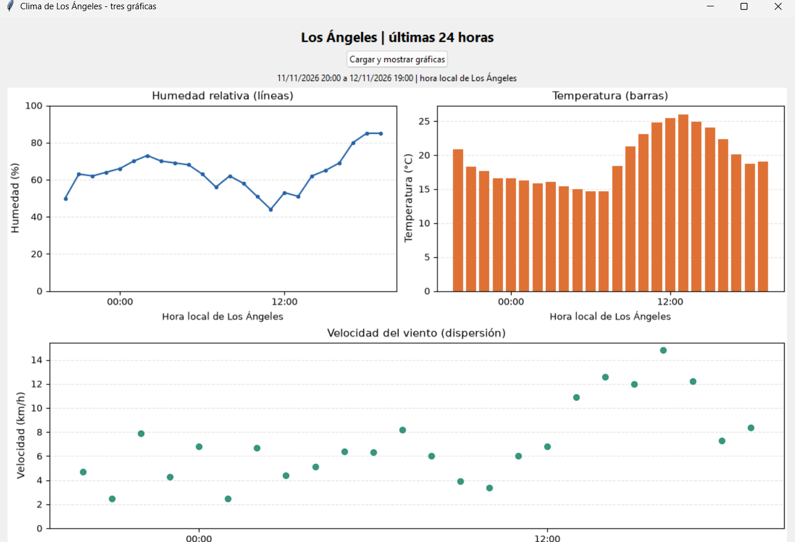
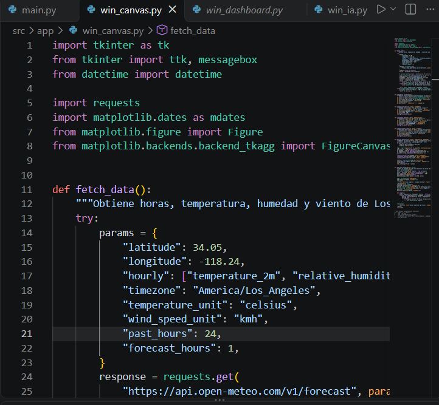
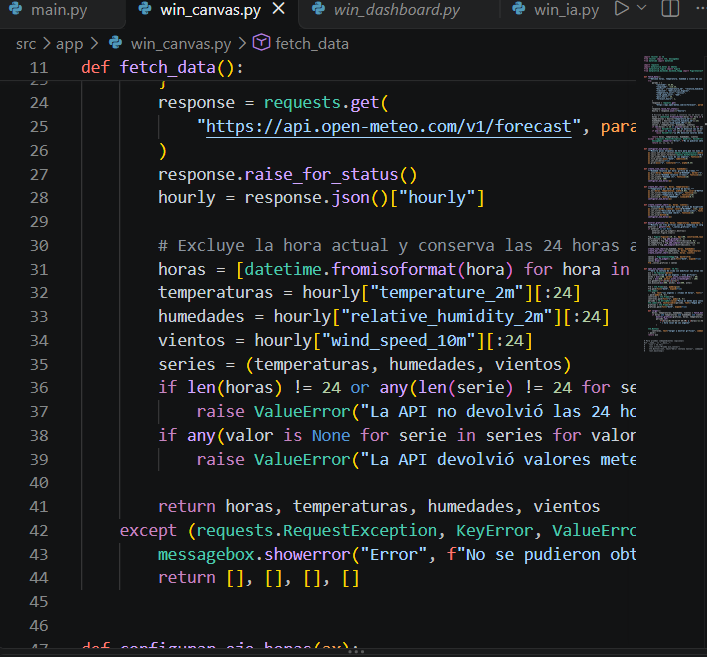
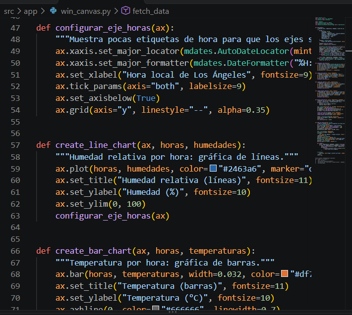
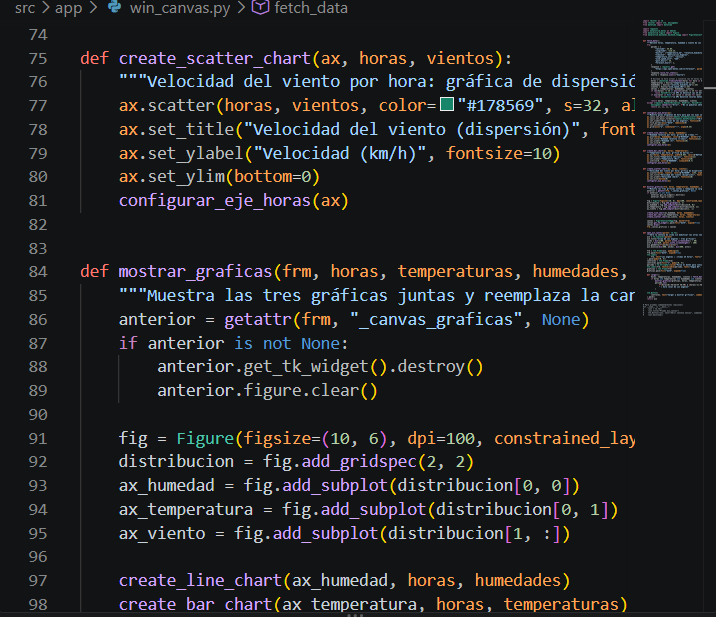
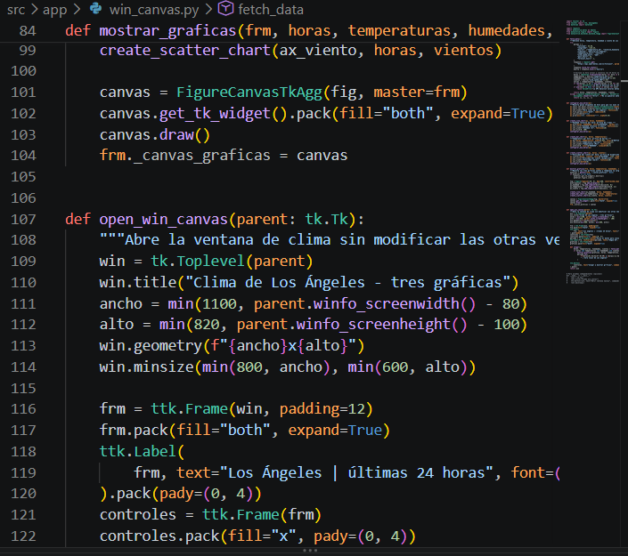
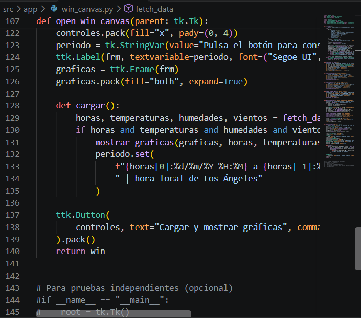

# WinCanvas con Open-Meteo - Paolo

**Integrante:** Paolo Humberto Luce Martínez.

**Otra entrega:** [D4 - Gate2: Inicio de LlegaBien, captura y código de WinHome](../D4-Gate2/README.md).

Esta carpeta contiene mi evidencia individual de la ventana `win_canvas.py`: la captura de las gráficas, mi explicación de los cambios y mi versión del código.

## Mi versión

| Elemento | Configuración |
| --- | --- |
| Ciudad | Los Ángeles |
| Coordenadas | Latitud `34.05`, longitud `-118.24` |
| Zona horaria | `America/Los_Angeles` |
| Rango de consulta | Las 24 horas anteriores, sin incluir la hora actual |
| Parámetros del periodo | `past_hours=24`, `forecast_hours=1`; se toman las primeras 24 muestras con `[:24]` |
| Diseño | Humedad y temperatura arriba, viento abajo ocupando todo el ancho |
| Humedad | Líneas azules con puntos, porcentaje (%) |
| Temperatura | Barras naranjas, grados Celsius (°C) |
| Viento | Puntos verdes, kilómetros por hora (km/h) |
| Elementos visuales | Títulos, ejes con unidades, horas locales y cuadrícula horizontal |

## Captura de la ventana

Esta es la captura incluida en mi PDF, con las tres gráficas cargadas. El periodo que aparece es del **11/11/2026 a las 20:00 al 12/11/2026 a las 19:00**, en la hora local de Los Ángeles.

## Cambios en el código

Para que las gráficas de Open-Meteo funcionaran, primero corregí la forma de consultar el API. Había mezclado dos métodos para conectarme y usaba herramientas que no estaban importadas. Lo cambié para utilizar `requests.get()`, revisar si la solicitud se realizó correctamente con `raise_for_status()` y convertir la respuesta a JSON con `.json()`. También corregí el nombre del campo de humedad a `relative_humidity_2m`, porque no coincidía con el que entrega la API.

Después puse las coordenadas de Los Ángeles y configuré la consulta para obtener las últimas 24 horas. Separé los datos de temperatura, humedad y velocidad del viento para usarlos en cada gráfica.

Hice una gráfica de líneas para la humedad, una de barras para la temperatura y una de puntos para el viento. Les agregué títulos, horas y unidades para que se entendieran mejor. También hice que al volver a cargar los datos se quitaran las gráficas anteriores. Todo esto lo cambié en `win_canvas.py`, sin afectar las otras ventanas.

## Código de mi entrega

- [Mi copia de win_canvas.py](codigo/win_canvas.py), conservada en esta carpeta como la versión de Paolo.
- [win_canvas.py que utiliza la aplicación](../../../src/app/win_canvas.py).

Al preparar esta evidencia, ambos archivos contienen el mismo código. La aplicación se sigue iniciando desde `main.py`.

## Capturas del código

Las siguientes seis capturas se extrajeron de mi PDF original, conservando su contenido.

Ver las capturas del código

### 1. Importaciones y parámetros de la consulta

### 2. Solicitud a la API y lectura de los datos

### 3. Ejes, humedad y temperatura

### 4. Viento y distribución de las gráficas

### 5. Canvas y ventana

### 6. Botón de carga y periodo mostrado

## Documento original

[API.pdf - evidencia original de Paolo](API.pdf).

[Volver a mis evidencias](../README.md).
