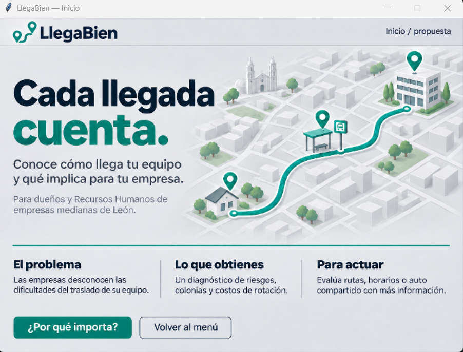
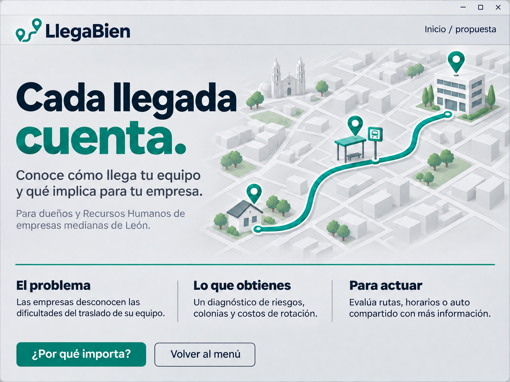

# D4 - Gate2: Inicio de LlegaBien

**Integrante:** Paolo Humberto Luce Martínez.

Esta es mi evidencia de la ventana `win_home.py`. Incluye la captura de la app, la imagen original de LlegaBien y una copia del código que se usó para mostrarla y hacer funcionar sus botones.

## Captura de la ventana

## Cómo hice esta parte

Para esta parte usé una imagen de LlegaBien como fondo de la ventana de inicio. Ahi se ve la idea y estilo de la app, el problema que busca resolver y a quién va dirigido. El código carga el archivo `inicio_llegabien.png` con `tk.PhotoImage` y lo coloca en un `Canvas` de Tkinter.

Después ajusté el tamaño de la imagen para que cupiera en la pantalla, sin que se viera rara. También recorté la barra superior que ya venía dibujada, porque la ventana de Tkinter tiene su propia barra. Guardé una referencia de la imagen en el Canvas para que siguiera visible mientras la ventana estuviera abierta.

Los botones forman parte de la imagen, así que agregué que le puedas dar click encima de esos botones. Cuando le picas a «¿Por qué importa?», aparece una explicación del proyecto. Al presionar «Volver al menú», se cierra esta ventana y vuelve a aparecer el menú principal. También se puede regresar picandole a la X.

Conservé el archivo `inicio_llegabien.b64` como respaldo: el código lo usa si el PNG cargado no tiene las dimensiones esperadas. Los dos recursos están junto a `win_home.py`, como los busca el programa.

## Código y recursos de mi entrega

| Archivo | Para qué sirve |
| --- | --- |
| [codigo/win_home.py](codigo/win_home.py) | Copia del código usado en la ventana de inicio |
| [codigo/inicio_llegabien.png](codigo/inicio_llegabien.png) | Imagen original de LlegaBien |
| [codigo/inicio_llegabien.b64](codigo/inicio_llegabien.b64) | Respaldo de la imagen en Base64 |
| [capturas/ventana-winhome.png](capturas/ventana-winhome.png) | Captura de la ventana funcionando |

La copia de `win_home.py` y sus recursos son idénticos a los de la aplicación al preparar esta entrega. El archivo que utiliza la app está en [src/app/win_home.py](../../../src/app/win_home.py) y se sigue abriendo desde el menú de `main.py`.

## Imagen original de LlegaBien

[Volver a mis evidencias](../README.md).
